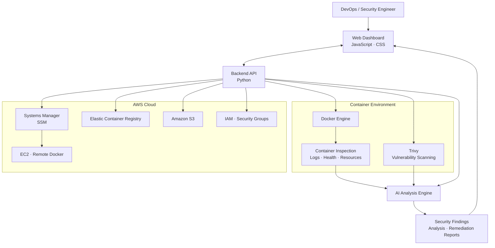

#                                              DevSecOps Agent

<p align="center">
  
  
  
  
</p>

<p align="center">
  An AI-powered security and infrastructure operations platform that brings vulnerability scanning, container inspection, cloud resource visibility, and intelligent remediation into one dashboard.
</p>

---

## Overview

**DevSecOps Agent** is a security-focused operations platform designed to simplify infrastructure monitoring, vulnerability detection, and cloud security workflows.

It combines container-level diagnostics, automated security scanning, cloud resource inspection, and AI-assisted analysis to help engineers identify risks, investigate issues, and make informed remediation decisions from a centralized dashboard.

The project brings DevSecOps practices closer to everyday infrastructure operations by connecting application security, container runtime visibility, and cloud infrastructure management in one place.

## Key Capabilities

### Container Security & Diagnostics

- Inspect local Docker containers and their runtime status.
- Review container logs, health checks, CPU usage, and memory consumption.
- Scan container images for known vulnerabilities using Trivy.
- Analyze findings and generate AI-assisted security insights.

### Cloud Infrastructure Security

- Inspect AWS EC2 infrastructure and security group configurations.
- Access EC2 Docker environments through AWS Systems Manager (SSM).
- Inspect Amazon ECR container image repositories.
- Review S3 resources and IAM-related configurations.

### AI-Assisted Security Analysis

- Interpret security findings and infrastructure diagnostics.
- Summarize potential risks in a more actionable format.
- Generate remediation reports to support troubleshooting and security improvements.

### Unified Operations Dashboard

- Centralized interface for infrastructure and security workflows.
- Visibility into container health and vulnerability findings.
- Access to local Docker environments and supported AWS resources.
- A single workspace for investigation and remediation planning.

## Architecture



The dashboard communicates with the backend API, which coordinates inspection and security operations across supported environments. Container diagnostics and vulnerability findings can be analyzed to provide security insights and remediation guidance.

Cloud operations use AWS services and the relevant access permissions to interact with infrastructure resources.

## Technology Stack

<p>
  
</p>

| Area | Technologies |
|---|---|
| Backend | Python |
| Frontend | JavaScript, CSS |
| Containerization | Docker, Docker Compose |
| Vulnerability Scanning | Trivy |
| Cloud Infrastructure | AWS EC2, ECR, S3, IAM |
| Remote Operations | AWS Systems Manager (SSM) |
| CI/CD | GitHub Actions |
| Cloud Authentication | GitHub Actions OIDC |
| AI Capabilities | AI-assisted analysis and remediation reporting |

## Security & DevSecOps Focus

The project focuses on integrating security into infrastructure operations rather than treating it as a separate, final-stage activity.

- **Shift-left security:** Identify container vulnerabilities during development and delivery workflows.
- **Runtime visibility:** Inspect container health, logs, and resource utilization.
- **Cloud security:** Examine supported AWS infrastructure and access configurations.
- **Automated delivery:** Use GitHub Actions to build Docker images and initiate remote deployment workflows.
- **Credential security:** Use GitHub Actions OpenID Connect (OIDC) for AWS role assumption rather than relying on long-lived AWS access keys in the deployment workflow.
- **Actionable remediation:** Turn diagnostic and vulnerability findings into understandable security reports.

## CI/CD & Deployment

The repository includes a GitHub Actions workflow designed to:

1. Build and verify the backend and frontend Docker images.
2. Authenticate to AWS using GitHub Actions OIDC.
3. Send a deployment command to the configured EC2 instance through AWS Systems Manager.
4. Update the application and rebuild its Docker Compose services on the target environment.

The deployment workflow separates image-build verification from the remote deployment stage.

## Project Highlights

- AI-assisted DevSecOps operations in a unified dashboard.
- Docker container inspection and runtime diagnostics.
- Trivy-based vulnerability scanning.
- AWS infrastructure inspection and remote operations.
- Security analysis and remediation reporting.
- OIDC-based AWS authentication for CI/CD.
- Docker Compose-based application deployment.

## Repository Structure

```text
devsecops-agent/
├── backend/                 # Backend application
├── frontend/                # Web dashboard
├── docs/                    # Project documentation
├── prompts/                 # AI analysis prompts
├── .github/
│   └── workflows/
│       └── deploy.yml       # CI/CD and SSM deployment
├── docker-compose.yml       # Container orchestration
├── .env.example             # Environment configuration template
├── DOCKER-RUNBOOK.md        # Docker operations reference
└── .gitignore
```

## Project Vision

The long-term vision of DevSecOps Agent is to make infrastructure security more accessible, observable, and actionable by bringing container diagnostics, vulnerability intelligence, cloud operations, and AI-assisted remediation together.

The goal is to help engineers move from **detecting issues** to **understanding risks** and **making better remediation decisions** through a unified operational experience.

---

<p align="center">
  Built for secure infrastructure, automated operations, and continuous improvement.
</p>

<p align="center">
  <a href="https://github.com/tanahmeeedsx">Tanjim Ahmed</a>
</p>
