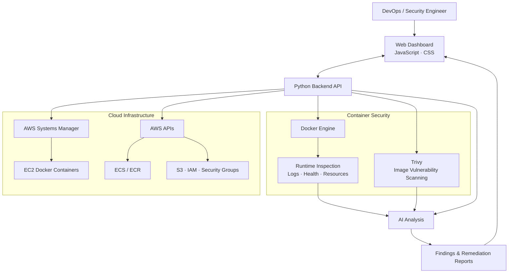

# DevSecOps Agent — AI-Powered Container & Cloud Security Platform

<p align="center">
  
  
  
</p>

<p align="center">
  An intelligent security operations dashboard for container inspection, vulnerability scanning, cloud infrastructure visibility, and AI-assisted remediation.
</p>

<p align="center">
  <a href="https://github.com/tanahmeeedsx/devsecops-agent">Repository</a> ·
  <a href="https://github.com/tanahmeeedsx/devsecops-agent/issues">Issues</a>
</p>

---

## Technology Stack

<p align="center">
  
</p>

<p align="center">
  
  
  
  
</p>

## Overview

DevSecOps Agent brings container security, infrastructure inspection, and AI-assisted analysis into a centralized dashboard. It helps engineers investigate vulnerabilities, inspect runtime health, review cloud configurations, and understand potential security risks.

## Architecture



## Core Features

- **Container Inspection** — View container status, logs, health checks, CPU and memory usage.
- **Vulnerability Scanning** — Scan container images with Trivy to identify known vulnerabilities.
- **Cloud Security** — Inspect supported AWS resources, including EC2, ECS, ECR, S3, IAM and security groups.
- **Remote EC2 Operations** — Inspect Docker containers on EC2 through AWS Systems Manager (SSM).
- **AI-Assisted Analysis** — Interpret findings and generate security insights and remediation reports.
- **Unified Dashboard** — Access container diagnostics and supported cloud security workflows from one interface.

## CI/CD & Deployment

The GitHub Actions workflow automates the application's build and deployment process.

1. Builds the backend and frontend Docker images.
2. Authenticates to AWS using GitHub Actions OIDC.
3. Sends a deployment command to EC2 through AWS Systems Manager.
4. Pulls the latest code and rebuilds services using Docker Compose.

## Repository Structure

```text
devsecops-agent/
├── .github/workflows/
│   └── deploy.yml
├── backend/
├── frontend/
├── docs/
├── prompts/
├── docker-compose.yml
├── .env.example
├── DOCKER-RUNBOOK.md
└── .gitignore
```

## Security Focus

- Container vulnerability detection
- Infrastructure and runtime visibility
- Cloud configuration inspection
- OIDC-based AWS authentication for CI/CD
- AI-assisted security analysis and remediation guidance

## Project Vision

To make infrastructure security more observable and actionable by combining container diagnostics, cloud security inspection, vulnerability intelligence, and AI-assisted remediation in one platform.

---

<p align="center">
  <a href="https://github.com/tanahmeeedsx">Tanjim Ahmed</a>
</p>

<p align="center">
  <sub>Secure Infrastructure · Intelligent Automation · Continuous Security</sub>
</p>
